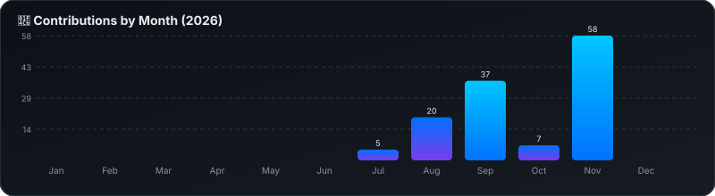
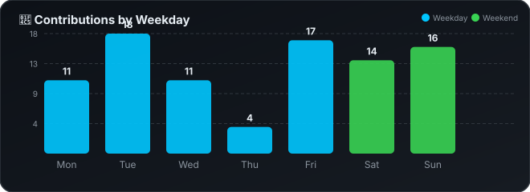
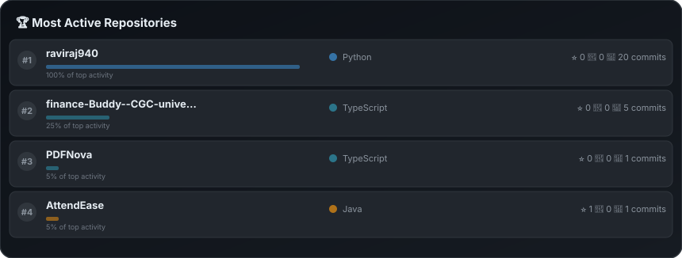

<!-- ========================= -->
<!--        HERO SECTION       -->
<!-- ========================= -->

  

<h2 align="center">
  Problem Solver · Data Explorer · ML Enthusiast
</h2>

  <i>
    🎓 Computer Science student from India, building data-driven solutions
    and solving real-world problems with Python, AI/ML &amp; SQL.
  </i>

 

<!-- ========================= -->
<!--      SOCIAL BUTTONS       -->
<!-- ========================= -->

<!-- ========================= -->
<!--       GRADIENT LINE       -->
<!-- ========================= -->

  

 

<!-- ========================= -->
<!--         ABOUT ME          -->
<!-- ========================= -->

<h2>👨‍💻 About Me</h2>

I'm <b>Ravi Raj</b>, a Computer Science student from India.

I enjoy working with data, solving problems, discovering meaningful insights,
and building data-driven solutions that tackle real-world challenges.

<ul>
<li>🚀 I build practical data-driven projects using Python &amp; ML</li>
<li>🤖 Exploring AI, Machine Learning &amp; intelligent automation</li>
<li>🗄️ Working with SQL databases and data pipelines</li>
<li>☕ I enjoy working with Java for object-oriented system design</li>
<li>💡 I enjoy turning complex problems into useful, clean solutions</li>
</ul>

<!-- ========================= -->
<!--         INTERESTS         -->
<!-- ========================= -->

<h2>🔭 Interests</h2>

<table align="center">
<tr>
<th>Area</th>
<th>Focus</th>
</tr>

<tr>
<td align="center">📊</td>
<td><b>Data Science</b> — finding stories hidden in messy data</td>
</tr>

<tr>
<td align="center">🤖</td>
<td><b>AI &amp; ML</b> — building models that solve real problems</td>
</tr>

<tr>
<td align="center">🐍</td>
<td><b>Python</b> — data analysis, scripting and automation</td>
</tr>

<tr>
<td align="center">🗄️</td>
<td><b>SQL</b> — querying, transforming and managing data</td>
</tr>

<tr>
<td align="center">☕</td>
<td><b>Java</b> — object-oriented software development</td>
</tr>

<tr>
<td align="center">⚙️</td>
<td><b>Automation</b> — turning repetitive tasks into useful workflows</td>
</tr>

<tr>
<td align="center">🛠️</td>
<td><b>Tool Building</b> — solving problems with clean, purposeful code</td>
</tr>

</table>

 

<!-- ========================= -->
<!--        TECH STACK         -->
<!-- ========================= -->

<h2>🧰 Tech Stack</h2>

<h3>💻 Languages &amp; Core</h3>

<h3>📊 Data &amp; Analysis</h3>

<h3>🤖 AI &amp; Machine Learning</h3>

<h3>🛠️ Tools &amp; Platforms</h3>

<!-- ========================= -->
<!--   GITHUB WRAPPED SECTION  -->
<!-- ========================= -->

## 📊 GitHub Wrapped – My Coding Journey

  

 

---

### 📈 GitHub Activity Graph

  

 

---

### 📊 GitHub Stats  &  🔥 Streak

  
  

 

---

### 🧑‍💻 Most Used Languages

  
  &nbsp;&nbsp;&nbsp;
  

 

---

### 🏆 GitHub Trophies

  

 

---

### 📋 Contribution Summary

  

 

---

### 🤖 Auto-Updated Analytics Charts

> 📌 These charts are generated from the **GitHub GraphQL API** and auto-committed daily by [GitHub Actions](.github/workflows/github-wrapped.yml).

 

<b>📆 Monthly Contributions</b>

  

 

<b>📅 Contributions by Weekday</b>

  

 

<b>🏆 Most Active Repositories</b>

  

<!-- ========================= -->
<!--      MACHINE LEARNING     -->
<!-- ========================= -->

<h2>🧠 Currently Learning</h2>

<ul>
<li>🔢 <b>Regression</b> — predicting continuous values from data</li>
<li>🏷️ <b>Classification</b> — building intelligent decision systems</li>
<li>🔵 <b>Clustering</b> — discovering hidden structure in datasets</li>
<li>🧪 <b>Feature Engineering</b> — transforming raw data into model-ready inputs</li>
<li>🤖 <b>Deep Learning</b> — exploring neural networks with TensorFlow</li>
<li>📊 <b>Data Visualization</b> — telling stories through charts and dashboards</li>
</ul>

<!-- ========================= -->
<!--     FEATURED PROJECTS     -->
<!-- ========================= -->

<h2>🚀 Featured Projects</h2>

<h3>🧑‍💻 AttendEase — Face Recognition Attendance System</h3>

<b>Java | Face Recognition | Attendance Management</b>

A face recognition based attendance management system developed
to automate attendance recording — eliminating manual roll calls completely.

<b>Key Features:</b>

<ul>
<li>🎭 Real-time face detection and recognition</li>
<li>📋 Automated attendance recording and logging</li>
<li>📊 Attendance management and reporting</li>
<li>☕ Built with Java — robust and cross-platform</li>
</ul>

🔗
<a href="https://github.com/raviraj940/AttendEase">
View Project → AttendEase
</a>

 

<h3>📄 PDFNova — PDF Management Platform</h3>

<b>TypeScript | PDF Processing | Web Application</b>

A modern PDF toolkit designed for effortlessly working with PDF documents —
merge, split, compress and convert with a clean web interface.

<b>Key Features:</b>

<ul>
<li>📎 Merge multiple PDF files into one</li>
<li>✂️ Split PDF files by page range</li>
<li>🗜️ Compress PDF files for smaller size</li>
<li>🔄 Convert PDF files to other formats</li>
<li>🗂️ Organize and manage PDF documents</li>
<li>🔒 Secure and password-protect PDF files</li>
</ul>

🔗
<a href="https://github.com/raviraj940/PDFNova">
View Project → PDFNova
</a>

<!-- ========================= -->
<!--    FUN FACTS & PHILOSOPHY -->
<!-- ========================= -->

  

<h2>🌙 Fun Facts &amp; Philosophy</h2>

<ul>

<li>
🧪 <b>Experiment Mindset</b> —
I like experimenting with projects, tools and technologies.
</li>

<li>
📁 <b>Never-Ending Backlog</b> —
I always have another project idea waiting to be built.
</li>

<li>
🤖 <b>Automation Mindset</b> —
If a task is repetitive, I look for a way to simplify it.
</li>

<li>
💻 <b>Terminal Friendly</b> —
I enjoy working directly with code and development tools.
</li>

<li>
⚡ <b>Fast Iteration</b> —
Build first, learn from the result, then improve.
</li>

<li>
📊 <b>Data First</b> —
Every decision is better with the right data behind it.
</li>

</ul>

<!-- ========================= -->
<!--       LET'S CONNECT       -->
<!-- ========================= -->

  

<h2>🎯 Let's Connect!</h2>

I'm always open to collaborations, interesting problems,
data projects, or just a good chat about technology and automation.

<b>Reach out on any of these platforms:</b>

 

<!-- ========================= -->
<!--        QUICK STATS        -->
<!-- ========================= -->

<h2 align="center">💡 Quick Stats</h2>

<b>Built with curiosity, powered by data, and driven by learning. ⭐</b>

<i>
Feel free to explore anything useful from my repositories —
that's what code is for.
</i>

 

<!-- ========================= -->
<!--          FOOTER           -->
<!-- ========================= -->

  📊 GitHub Wrapped charts auto-updated daily via GitHub Actions • Last chart update: see <a href=".github/workflows/github-wrapped.yml">workflow</a>

